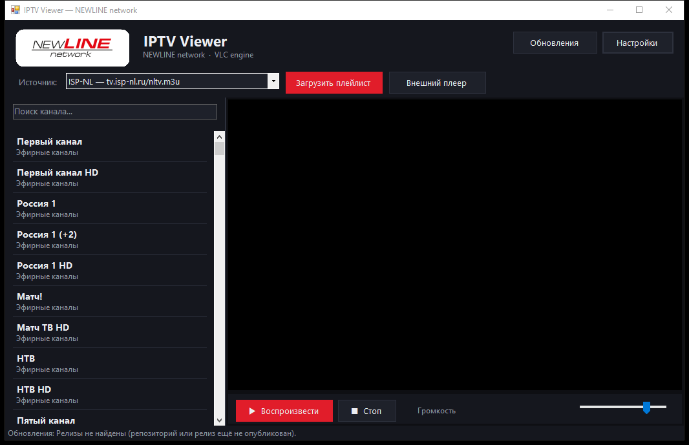

# IPTV Viewer — NEWLINE network

Портативный IPTV-плеер для Windows с тёмной и светлой темами, оригинальным логотипом
NEWLINE network и движком **VLC** (LibVLCSharp). Поддерживает Windows 7 SP1 и новее.



## Возможности

- Тёмная и светлая темы интерфейса (переключаются в настройках без перезапуска).
- Заставка с оригинальным логотипом NEWLINE network.
- Два источника плейлистов — кнопки **IPTVPORTAL** и **IPTV**:
  - `IPTVPortal` — https://newline.iptvportal.ru/
  - `ISP-NL` — http://tv.isp-nl.ru/nltv.m3u
- Воспроизведение через VLC: HLS (`.m3u8`), HTTP-потоки и другие форматы.
- **Полный экран**: F11 или двойной клик по видео, `Esc` — выход. В полном
  экране список каналов плавно появляется справа при движении мыши и
  скрывается в простое.
- **Телепрограмма (EPG)**:
  - загружается из плейлиста (тег `url-tvg`), кэшируется на диск;
  - текущая передача отображается прямо в списке каналов
    (при наведении и на выбранном канале);
  - **правый клик по каналу** открывает полную телепрограмму с подсветкой
    передачи «сейчас в эфире» и кнопкой «Смотреть канал».
- Поиск каналов по названию и группе.
- Регулировка громкости, запуск во внешнем проигрывателе.
- Список каналов справа, статусная строка.
- Настройки в `%LOCALAPPDATA%\IPTVViewer\settings.json` (создаются автоматически).
- **Автоматическая проверка обновлений** из GitHub Releases при запуске,
  ручная проверка — в окне «Настройки → Проверить обновления».

## Скачать

Готовые файлы: раздел [Releases](../../releases) репозитория.

1. Скачайте `IPTVViewer.exe` — **единый файл**: движок VLC встроен внутрь
   и распаковывается при первом запуске в `%LOCALAPPDATA%\IPTVViewer\vlc`.
2. Либо скачайте `IPTVViewer_Newline_VLC.zip` (портативный вариант
   с папкой `libvlc`), распакуйте в любую папку и запустите `IPTVViewer.exe`.

> В портативной версии папку `libvlc` нельзя удалять или переносить —
> это движок VLC, он должен находиться рядом с `IPTVViewer.exe`.
> При использовании единого `IPTVViewer.exe` первый запуск занимает
> несколько секунд дольше (распаковка движка), дальнейшие — мгновенно.

## Требования

- Windows 7 SP1 / 8 / 8.1 / 10 / 11 (x86 или x64).
- .NET Framework 4.8 (на Windows 10/11 уже установлен; на Windows 7
  устанавливается отдельно с сайта Microsoft).

## Сборка из исходников

```powershell
cd IPTVViewer
powershell -File pack_vlc.ps1      # создание vlc-data\vlc-x64.zip / vlc-x86.zip
dotnet build IPTVViewer.csproj -c Release
```

Результат: `bin\Release\net48\IPTVViewer.exe` (единый exe со встроенным VLC)
или `bin\Release\net48` вместе с папкой `libvlc` (портативный вариант).

Для портативного архива скопируйте содержимое `bin\Release\net48`
в отдельную папку и упакуйте в ZIP (папка `libvlc` обязательна).

## Проверка обновлений

Приложение запрашивает последний релиз через GitHub API:

```
https://api.github.com/repos/<owner>/<repo>/releases/latest
```

- Версия сравнивается с `tag_name` релиза (например, `v2.1.0`).
- Если версия новее — открывается окно со списком изменений и кнопкой
  скачивания архива.
- Если обновление не требуется, приложение сообщает
  «Используется актуальная версия».
- Репозиторий проверки не показывается, в настройках есть только
  переключатель автопроверки.
- Диагностика без запуска интерфейса:

```powershell
IPTVViewer.exe --check-updates
```

Результат записывается в `%LOCALAPPDATA%\IPTVViewer\updatecheck.log`.

## Публикация релиза

1. Поднимите `<Version>` в `IPTVViewer/IPTVViewer.csproj`.
2. Соберите проект и упакуйте `dist` в `IPTVViewer_Newline_VLC.zip`.
3. Создайте на GitHub релиз с тегом `vX.Y.Z` (совпадает с версией сборки)
   и прикрепите ZIP как asset.

## Структура проекта

| Файл | Назначение |
| --- | --- |
| `MainForm.cs` | Главное окно, список каналов, полный экран, EPG |
| `EpgLoader.cs` | Скачивание, разбор и кэширование XMLTV |
| `EpgForm.cs` | Окно телепрограммы канала |
| `VlcLocator.cs` | Поиск/распаковка движка VLC (единый exe) |
| `DepsLoader.cs` | Загрузка LibVLCSharp из ресурсов (единый exe) |
| `AppIcon.cs` / `Resources\app.ico` | Иконка NL для exe и всех окон |
| `pack_vlc.ps1` | Упаковка VLC в vlc-data для встраивания |
| `UpdateChecker.cs` | Запрос релизов GitHub и сравнение версий |
| `UpdateForm.cs` | Окно обновления и загрузка архива |
| `SettingsManager.cs` | Настройки в LocalAppData |
| `PlaylistLoader.cs` | Загрузка и разбор M3U |
| `Theme.cs` | Тёмная и светлая темы |
| `DarkCheckBox.cs` | Собственный чекбокс под обе темы |
| `SplashForm.cs` | Заставка с логотипом |

## Лицензия

Проект распространяется как есть, для личного использования.
Плейлисты предоставляются их владельцами; приложение не содержит телеканалов.
